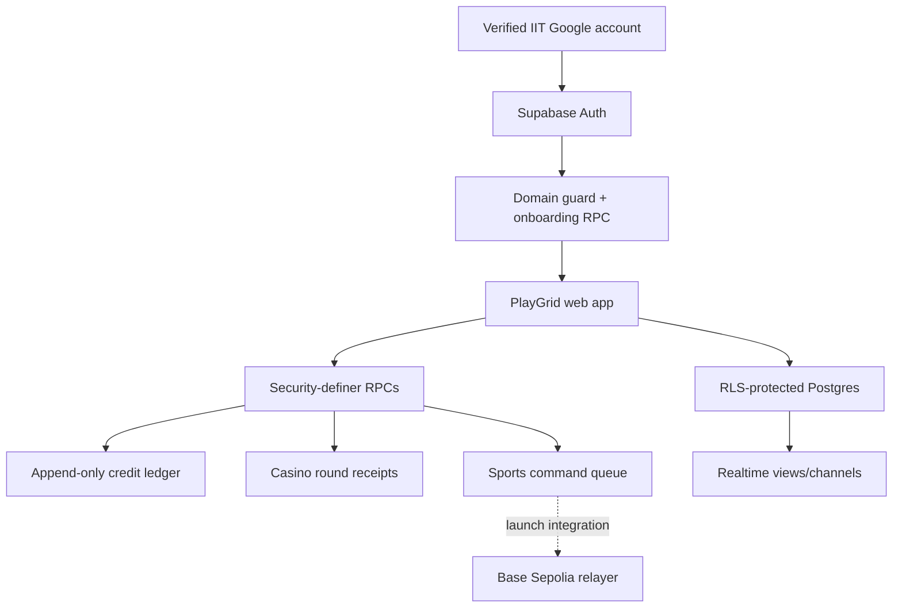

# PlayGrid System Design

Status: working private MVP with explicit launch gates.

## Product boundary

PlayGrid is a closed-loop social game for verified IIT Google Workspace
accounts. Sports and Arcade credits are independent integer ledgers with no
purchase, transfer, redemption, withdrawal, or real-world value. An admin
cannot bypass the ledger or silently rewrite history.

## Runtime architecture

The Sites-hosted Next.js-compatible frontend never receives a service-role key.
All member mutations go through narrow authenticated RPCs. Row Level Security
limits reads by ownership or explicit public visibility.

## Authentication and membership

1. The only entry point is Google OAuth.
2. A database trigger rejects `auth.users` inserts unless the provider is
   Google, the email is verified, and its normalized domain matches an enabled
   IIT root or subdomain in `iit_domains`.
3. The equivalent Before User Created Hook exists in SQL and should be enabled
   in Supabase Auth before launch so rejection happens before account creation.
4. `finish_onboarding` creates the profile and grants the one-time 500 Sports +
   500 Arcade welcome allocation atomically.
5. A username may be chosen once and renamed once. Referral rewards are
   idempotent and ledger-backed.

Email-domain verification proves control of an eligible institutional account;
it does not by itself prove current enrollment.

### Isolated demo access

The login page also exposes temporary Student Demo and Admin Demo sessions for
product testing while Google OAuth is being configured. Demo access is not a
Supabase identity and never creates a JWT, profile, or database row.

- The selected demo role is stored in versioned, tab-scoped `sessionStorage`.
- Demo profiles and balances are canonical in application code; arbitrary
  browser-provided profile or balance values are not trusted.
- Sports and casino demo actions bypass Supabase RPCs and return local sample
  receipts/results.
- Admin Demo unlocks only the seeded control-room interface. It cannot satisfy
  database authorization, AAL2, capabilities, or maker-checker rules.
- A visible banner and account badge identify every demo surface. Users can
  switch roles or exit from the account menu, and the session disappears when
  the tab is closed.

Real accounts still use Google OAuth only. Demo access must never be accepted by
server-side authorization or used to relax RLS.

## Authorization

Students and admins use separate route spaces. Admin access requires:

- an explicit `profiles.role = 'admin'` assignment;
- Supabase MFA at AAL2;
- product-specific capabilities for sensitive actions;
- reasons, immutable audit events, and maker-checker approval for high-impact
  changes.

There is intentionally no raw SQL console in the product. Ledger rows, casino
rounds, and audit events are append-only. Corrections are new compensating
entries.

## Sports

The UI follows a dense event-card and sticky-slip interaction model. Outcomes
show an implied pool share and projected multiplier. `place_sports_bet`
validates the account, balance, event state, 1.05x floor, and idempotency before
reserving credits and creating a queued command.

The queue-to-contract relayer, Base Sepolia contract, indexer, reconciliation,
finalization, and claim path remain a launch gate. The interface therefore says
“request accepted,” not “bet settled.” No CLOB, selling, cash-out, or monetary
language is used.

## Casino

Dice and Plinko use the authenticated `play_casino_round` RPC and return
versioned verification receipts. Mines currently has the complete interactive
client experience but needs a server-authoritative multi-step session before
launch.

PF-v1 is a verification prototype. Production requires an independent
KMS-backed seed service that publishes a commitment before accepting a round,
rotates secrets, reveals settled seeds, and exposes a standalone verifier.

## Data and realtime

Core tables include profiles, username history, credit accounts, append-only
ledger entries, referrals, sports events/markets/outcomes, sports commands,
casino rounds, admin ACL, and audit events.

Postgres is the source of truth. Realtime is for low-latency UI updates only;
clients must recover current state from queryable tables after reconnecting.

## UI system

The product uses original PlayGrid branding and assets:

- deep navy canvas, raised slate surfaces, iris primary action;
- mint success, coral loss, amber warning;
- fixed desktop navigation and compact mobile navigation;
- dense market cards and sticky sports slip;
- compact casino controls with large, original CSS game canvases.

It borrows familiar interaction patterns from modern prediction and casino
products without copying trademarks, brand assets, wording, or trade dress.

## Launch gates

| Gate | Current state | Required action |
|---|---|---|
| Google OAuth provider | External setup required | Create OAuth credentials, configure Supabase provider and callback URLs |
| Auth hook | Function ready | Enable `hook_restrict_iit_google` in Supabase Auth |
| Initial admin | Not assigned | Enroll MFA, then grant role/capabilities through a controlled bootstrap |
| Admin mutations | UI prototype | Add audited maker-checker RPCs and integration tests |
| Sports chain | Queue ready | Deploy contract/relayer/indexer/reconciler on Base Sepolia |
| Casino fairness | PF-v1 prototype | Add KMS pre-commit/reveal service and verifier |
| Mines authority | Client prototype | Implement server-side multi-step state machine |
| Legal/provider review | Not a code task | Obtain written launch clearance before student-facing release |

The site must remain private until every launch gate that affects a user-facing
flow is closed.
